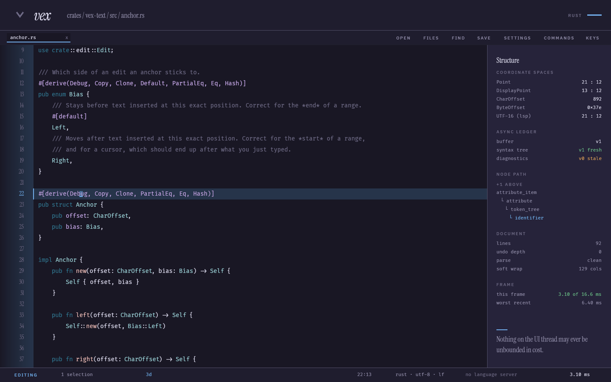
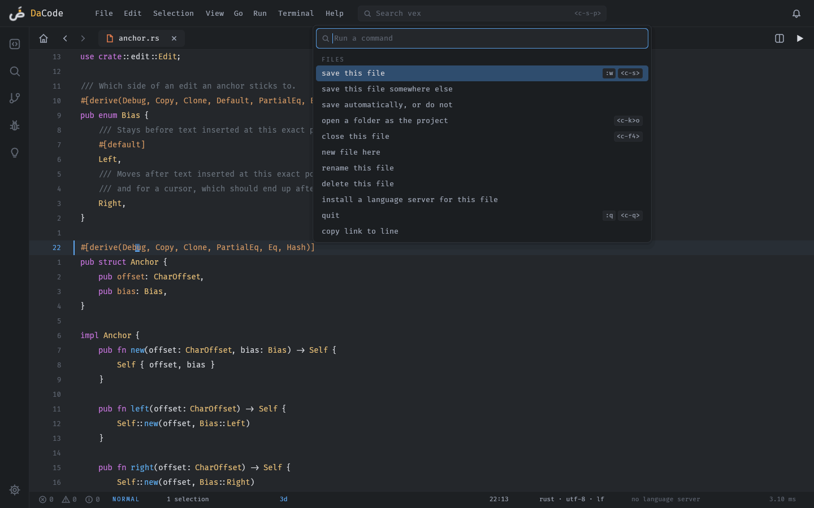
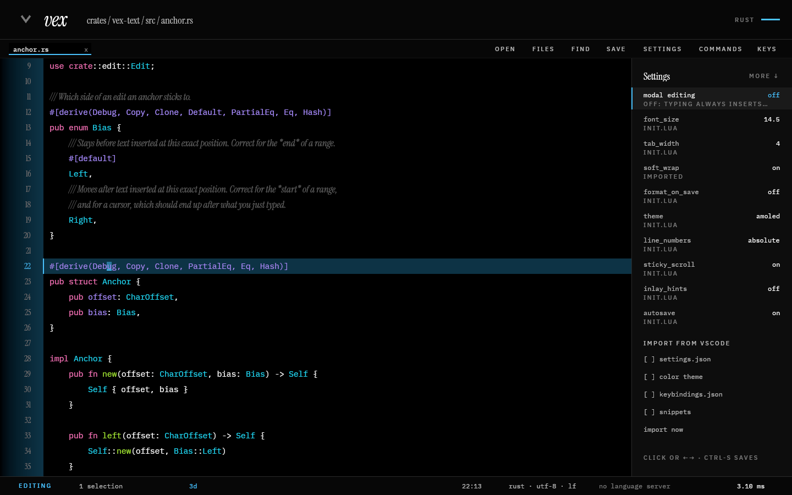
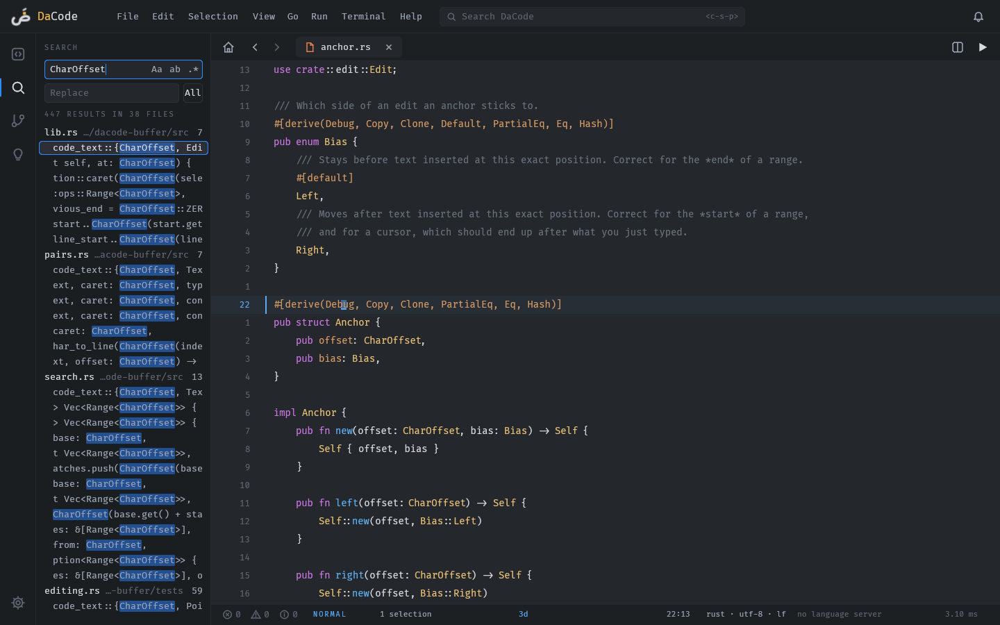

<div align="center">

<picture>
  <source media="(prefers-color-scheme: dark)" srcset="logo/dacode/mark-on-dark-128.png">
  
</picture>

# DaCode

**A code editor that never stalls on your keystroke.**

[](https://github.com/Gawad-B/DaCode/actions/workflows/build.yml)
[](https://github.com/Gawad-B/DaCode/releases/latest)
[](LICENSE)

[Install](#install) · [Documentation](docs/) · [Keys](CHEATSHEET.md) · [Changelog](CHANGELOG.md)

</div>

---

> **A vibe-coded project**
>
> - I don't know Rust: the code was written with AI.
> - I chose the architecture and the design system.
> - I designed the editor and its landing page.
> - Built for my own use, published so anyone can try it.

Rust, `winit` + `wgpu` + `glyphon` — drawn straight onto the GPU, with no GUI framework and no web
view. Tree-sitter highlighting, language servers over LSP, splits, a file tree, project-wide search
and replace, a git gutter and a command palette. Vim's grammar if you want it, a conventional editor
if you don't.

One rule is enforced above every other: **nothing unbounded ever runs on the UI thread.** That is why
a keystroke costs the same in a 100,000-line file as in a ten-line one — about 7 µs either way — and
it is asserted by a test that fails the build if it stops being true.



## Against VSCode

Measured from outside both editors on one laptop (i5-1135G7, Fedora 44, kernel 7.2.13), on
2026-10-31. VSCode 1.143.1 ran on a fresh profile with no extensions and AI features off. Both opened
the same CSS file with no language server running.

| | DaCode | VSCode | |
|---|---:|---:|---|
| Startup, to the file highlighted on screen (median of 10) | 182 ms | 3,331 ms | 18x faster |
| Keystroke, key press to changed pixels (median of 200) | 5.1 ms | 13.4 ms | 2.6x faster |
| Keystroke, 95th percentile | 5.8 ms | 17.2 ms | 3x faster |
| Memory, one file open (PSS, every process) | 64 MB | 820 MB | 13x less |
| Memory, a 100,000-line file open | 106 MB | 909 MB | 8.6x less |
| Opening that 100,000-line file | 1,203 ms | 3,892 ms | 3.2x faster |
| CPU while idle | 0.00% | 0.50% | |
| Installed size | 41 MB | 1,031 MB | 25x smaller |
| Processes | 1 | 10 | |

DaCode does about three quarters of what VSCode does out of the box: 27 of 39 checked features
fully, 5 in part and 7 not at all. The missing ones are a debugger, an extension marketplace, remote
development, notebooks, a test explorer, settings sync and multi-root workspaces. The
[landing page](web/) has the full checklist. [bench/compare](bench/compare/README.md) has the
harness, what it measures and what it does not, and how to run it yourself.

## Install

**Windows** — download [`dacode-setup.exe`](https://github.com/Gawad-B/DaCode/releases/latest) and run it.
It installs per-user under `%LOCALAPPDATA%\Programs\dacode`, so there is no UAC prompt, and it adds a
Start Menu entry, `dacode` on your `PATH`, "Open with DaCode" on a folder's right-click menu, and an
uninstaller.

**macOS** — download `dacode-<version>-macos.dmg`, open it and drag DaCode into Applications. One
build for Apple Silicon and Intel, macOS 11 or later. It is not signed with an Apple Developer ID
yet, so the first launch needs a right-click → **Open** (details in
[Getting started](docs/getting-started.md#macos)). ⌘ does what Ctrl does everywhere else, the left
Option key is Alt, and **Open With** in the Finder or a drop on the Dock icon opens a file or a
folder.

**Debian, Ubuntu, Mint**

```sh
sudo apt install ./dacode_1.2.0_amd64.deb
```

**Fedora, RHEL, openSUSE**

```sh
sudo dnf install ./dacode-1.2.0-1.x86_64.rpm
```

**Any Linux, no package manager**

```sh
tar xzf dacode-1.2.0-x86_64-linux.tar.gz
./dacode-1.2.0-x86_64-linux/install.sh        # into ~/.local, no root needed
```

**From source** — needs Rust 1.85 or newer.

```sh
cargo build --release && packaging/linux/install.sh
```

Every artifact is on the [releases page](https://github.com/Gawad-B/DaCode/releases/latest). After
that, a tarball, Windows or Mac install updates itself: DaCode checks once a day, downloads and verifies
the new release, and offers **Restart now** in the bell. A `.deb` or `.rpm` install is told the
command to run instead — [Staying up to date](docs/getting-started.md#staying-up-to-date) has the
details.
[Getting started](docs/getting-started.md) walks through the rest.

## Start

```sh
dacode path/to/file.rs      # a file
dacode path/to/project      # a folder: indexes it and opens the file tree
dacode                      # nothing: reopens the last project you worked in
```

Started with no argument — from a Start Menu entry, a desktop icon, a dock — DaCode reopens the last
project you were in, with the files you had open. Not the current working directory, which for a
launcher is wherever the shortcut happened to point.

On first run it asks three questions — how you want to type, which theme, and whether to bring
anything over from VSCode — writes the answers to your config, and never appears again.

## You do not have to learn it first

The title bar carries a menu bar — File, Edit, Selection, View, Go, Run, Terminal, Help — that is
always there to click, and <kbd>F10</kbd> opens it from the keyboard. There are buttons along the
top, a right-click menu with the clipboard and language-server verbs, and a settings tab you
change by clicking, with a search box, an explanation under each setting that needs one, and saving
that happens by itself. Every one of them prints the shortcut for what it does, so the mouse teaches the
keyboard and then gets out of the way.

|  |  |
|---|---|
| <kbd>F1</kbd> | every key that works *right now*, in the grammar you actually chose |
| <kbd>ctrl</kbd>+<kbd>shift</kbd>+<kbd>P</kbd> | every command, searchable, with its key beside it |
| <kbd>ctrl</kbd>+<kbd>,</kbd> | settings, as a tab: searchable, explained, and written to `init.lua` for you |
| <kbd>ctrl</kbd>+<kbd>shift</kbd>+<kbd>F</kbd> | search the whole project, and replace, in the sidebar |

 

**With Vim keys off you get a real conventional editor, not a modal one with the modes hidden.**
<kbd>ctrl</kbd>+<kbd>D</kbd> selects the next occurrence, <kbd>alt</kbd>+<kbd>↑</kbd> moves a line,
<kbd>ctrl</kbd>+<kbd>/</kbd> comments, double-click takes a word, alt-click adds a cursor, and copy
and paste go through the system clipboard. Vim reaches those by composition (`ddp`, `yyp`); with the
grammar off there is nothing to compose with, so they are bindings of their own.

**With Vim keys on** the grammar composes as you expect — `3dw`, `d2f)`, `ci"`, `"ayy`, `.` to
repeat — and vertical motion follows *display* rows, so it moves through soft-wrapped lines the way
they look.

Every key both modes offer comes from [one table in the source][commands], which is also what the
palette, the help panel and the menus read. A test presses each of them through the real grammar, so
a shortcut this documentation claims that did nothing would fail the build.

[commands]: crates/dacode-input/src/commands.rs

## Search and replace across the project

<kbd>ctrl</kbd>+<kbd>shift</kbd>+<kbd>F</kbd>, or the magnifier in the icon column, opens search in
the sidebar, as in VSCode: a query box with match-case, whole-word and regex toggles
(<kbd>alt</kbd>+<kbd>C</kbd>, <kbd>alt</kbd>+<kbd>W</kbd>, <kbd>alt</kbd>+<kbd>R</kbd>), a replace
box, and the results grouped by file as they stream in. **All** replaces every match in the project.
It rewrites files and cannot be undone, so it asks to be pressed twice, and it leaves alone any file
you have open with unsaved changes. <kbd>ctrl</kbd>+<kbd>F</kbd> is still search in this file.



## Language support

Install a language server and DaCode drives it over LSP directly — or ask the editor to install it for
you, from the command palette. There is no marketplace and no extension runtime: **extension code is
never run**, because a JavaScript runtime is most of what makes VSCode heavy. Extension *data* —
themes, snippets, keybindings, language configuration — imports fine.

Rust, Python, TypeScript, JavaScript, C, C++, Go, Lua and Dart are recognised out of the box, and
[you can name your own](docs/guides/language-servers.md). HTML and CSS get Emmet, so `ul>li*3`
expands from the completion list. Completion carries each suggestion's type and brings its import
with it, and the arguments of the call you are typing into appear above it as you type `(` and `,`.
Formatting works through the server when it can and through `ruff`, `prettier`, `gofmt` or
`clang-format` when it cannot.

## Documentation

| | |
|---|---|
| **[Getting started](docs/getting-started.md)** | install, first run, and editing your first file |
| **[Guides](docs/guides/)** | keymaps, language servers, configuration, themes, migrating from VSCode |
| **[Reference](docs/reference/)** | [every setting](docs/reference/settings.md), [every flag and variable](docs/reference/cli.md), [every key](CHEATSHEET.md) |
| **[Architecture](docs/explanation/architecture.md)** | how it is put together, and why it stays responsive |
| **[PLAN.md](PLAN.md)** | the full design record, including the decisions that turned out wrong |
| **[CONTRIBUTING.md](CONTRIBUTING.md)** | building, testing, and the conventions that hold |

## Status

1.2.0 is the current release. DaCode is used daily by its author on Linux, and builds, installs and
passes its tests on Windows, where real use has found things no test could. On macOS it builds,
packages and passes its tests in CI, and **has not yet been used on a Mac by a person** — expect the
first reports to find things.

Known limitations, stated rather than hidden: buffer
search is still linear in the document, opening a file is still synchronous (though bounded), only
the *active* buffer gets a file watcher, a git diff and a language server, and replacing across the
project is not undoable.

## Licence

MIT — see [LICENSE](LICENSE). The one bundled font, Fira Code, is under the SIL Open Font License
1.1; see `crates/dacode-render/fonts/`. The logo is in `logo/dacode/`, generated with every icon by
`cargo run -p dacode --example icons` from the masks in `crates/dacode-render/assets/`.
