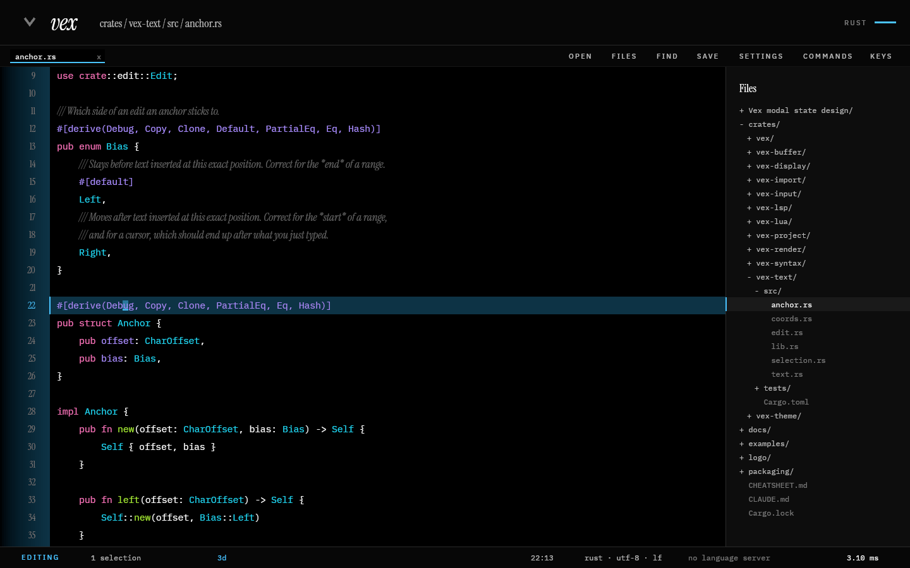

# Getting started

By the end of this you will have vex installed, configured the way you like to type, and you will
have opened a project, edited a file and saved it. It assumes you have never used vex and takes about
ten minutes. Nothing here needs a language server, a config file or a terminal.

If you already have vex running and want to do one specific thing, the [guides](guides/) are the
faster read.

## 1. Install it

Pick your platform. Every artifact is on the
[latest release](https://github.com/Gawad-B/Vex/releases/latest).

### Windows

Download `vex-setup.exe` and run it. It installs under `%LOCALAPPDATA%\Programs\vex`, which is
per-user — no administrator rights and no UAC prompt. When it finishes you have a Start Menu entry,
`vex` on your `PATH`, "Open with vex" on a folder's right-click menu, and an uninstaller.

Windows may warn that the publisher is unknown. The installer is unsigned; code-signing certificates
cost money this project does not have. You can verify what you downloaded against the release page.

### Debian, Ubuntu, Mint

```sh
sudo apt install ./vex_0.4.1_amd64.deb
```

### Fedora, RHEL, openSUSE

```sh
sudo dnf install ./vex-0.4.1-1.x86_64.rpm
```

### Any Linux, without a package manager

```sh
tar xzf vex-0.4.1-x86_64-linux.tar.gz
./vex-0.4.1-x86_64-linux/install.sh
```

That installs into `~/.local`, so it needs no root. Pass a prefix to put it elsewhere.

### From source

You need Rust 1.85 or newer. On Debian-family Linux you also need `libwayland-dev` and
`libxkbcommon-dev`; on Windows you need the MSVC build tools, because two crates compile C.

```sh
git clone https://github.com/Gawad-B/Vex
cd Vex
cargo build --release
packaging/linux/install.sh
```

### Check it worked

```sh
vex --version
```

You should see `vex 0.4.1`. On Windows this prints nothing when run directly in `cmd.exe` — the
release build is a windowed application and owns no console — but it works from PowerShell or when
piped. `vex --help` lists every flag.

## 2. Answer three questions

The first time vex starts with no configuration, it asks three things before anything else. You can
click the cards or use the arrow keys; every card shows the key that picks it.

**How do you want to type?** This is the one that matters. *Conventional* gives you the editor you
already know: typing inserts, <kbd>ctrl</kbd>+<kbd>C</kbd> copies, and there are no modes. *Vim*
gives you the modal grammar. Neither is a subset of the other, and you can change your mind later
from the settings panel — nothing about this decision is permanent.

**Which theme?** Five cards, each rendering the same code in its own theme, rather than five names.

**Anything to bring over from VSCode?** A checklist, with nothing ticked. Skip it for now; you can
import at any time, and [migrating from VSCode](guides/migrating-from-vscode.md) covers what comes
across.

The answers are written to your configuration and the wizard never appears again. Pressing
<kbd>esc</kbd> skips it *without* writing anything, so it comes back next time rather than vanishing
because of one stray keypress.

## 3. Open a project

Close vex and start it again, naming a folder:

```sh
vex ~/code/some-project
```

The folder you name becomes the project root — even if it sits inside a larger repository, because
asking for one crate should not index the whole workspace. vex indexes it in the background and opens
the file tree.

Three things are now available:

| | |
|---|---|
| <kbd>ctrl</kbd>+<kbd>E</kbd> | the file tree |
| <kbd>ctrl</kbd>+<kbd>P</kbd> | the file palette — type part of a name, press enter |
| <kbd>ctrl</kbd>+<kbd>shift</kbd>+<kbd>F</kbd> | search every file in the project |

You do not need any of them yet. Press <kbd>ctrl</kbd>+<kbd>P</kbd>, type a few letters of a file you
recognise, and press <kbd>enter</kbd>.



## 4. Edit something

If you chose conventional keys, type. If you chose Vim's, press <kbd>i</kbd> first — the statusline
at the bottom left tells you which mode you are in, and the cursor changes shape with it.

Then save with <kbd>ctrl</kbd>+<kbd>S</kbd>.

That is the whole loop. Everything else is optional.

## 5. Find your way around

You do not have to memorise anything. Three keys will answer almost any question you have:

**<kbd>F1</kbd>** lists every key that works *right now*, in the grammar you actually chose. Type to
filter it. If you are ever unsure whether a key does something, this is the honest answer — it reads
the same table the editor uses to dispatch.

**<kbd>ctrl</kbd>+<kbd>shift</kbd>+<kbd>P</kbd>** searches every command by name, with its shortcut
beside it. Use it twice for the same thing and you will have learned the shortcut without trying.

**<kbd>ctrl</kbd>+<kbd>,</kbd>** opens settings. Every option, its current value, and — the part a
configuration file cannot tell you — which of the default, your `init.lua` or an import last set it.
Click a row to change it.


There is also a toolbar along the top, a right-click menu, and a menu bar on <kbd>F10</kbd>. Every
one of them prints the shortcut for what it does, so using the mouse teaches you the keyboard.

## Where to go next

- **Diagnostics and completion** need a language server. vex can install one for you —
  [language servers](guides/language-servers.md).
- **Changing how it types** — [choosing how you type](guides/keymaps.md).
- **Changing how it looks** — [themes](guides/themes.md).
- **Configuration in a file** rather than the panel — [configuration](guides/configuration.md).
- **Every key** — [CHEATSHEET.md](../CHEATSHEET.md).

## If something goes wrong

vex writes a message across the bottom of the window rather than failing silently; it disappears when
you do something else. A configuration mistake gets a box at startup with a suggestion, and never
prevents the editor from opening.

Dirty buffers are written to a recovery directory every two seconds, so a crash or a `kill -9` costs
seconds rather than work — reopening the file offers the copy back. See
[files on disk](reference/files.md) for where that lives.

If vex is doing something wrong, [open an issue](https://github.com/Gawad-B/Vex/issues/new/choose).
The bug form asks for `vex --version` and your platform, which between them explain most of what is
otherwise guesswork.
